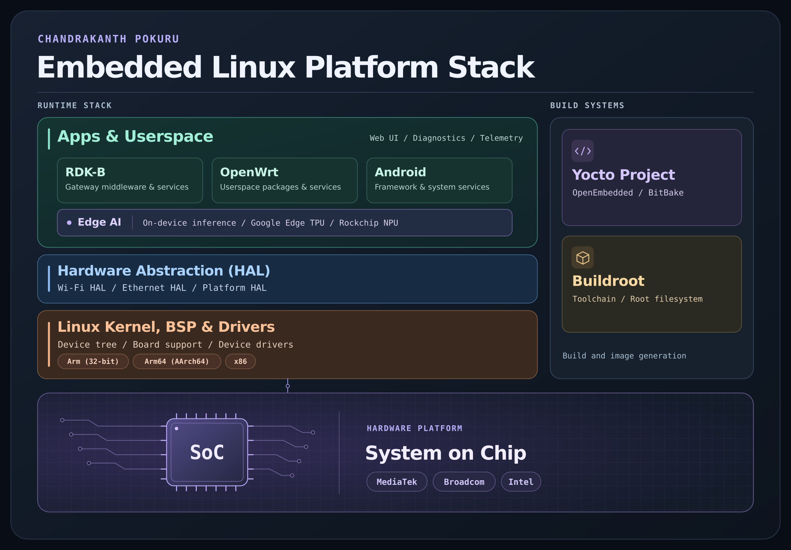

 

 

> *Software Engineer & Architect focused on RDK-B platforms, HAL abstraction, Edge AI, and TR-181/USP data models.*
> *15+ years designing and evolving broadband platform architectures across silicon vendors and operators.*

---

## 🧭 Architectural Focus

- 🔧 Broadband platform architecture (RDK-B, HAL Interface Spec, Southbound abstraction)
- 📋 TR-181 data model governance and USP/TR-369 integration
- 📡 WiFi 7 / EasyMesh bring-up on embedded Linux (BananaPi R4, MT7988 / Filogic)
- 🤖 Edge AI and AiMLOps pipelines for on-device broadband network diagnostics
- 📐 Hardware Compatibility Specifications and cross-vendor platform alignment
- 🛡️ AI-assisted governance tooling for open-source contribution pipelines

---

## 🤝 Community & Open-Source Contributions

- **RDK-B projects:** HAL Interface Spec, TR-181 data model, USP/TR-369, EasyMesh, AiMLOps
- **Other projects:** Broadband platform docs, spec tooling, and AI governance bots

---

## 🛠️ Tech Stack

---

## 🪶 Domains & Technologies

| Area | Focus |
|:---|:---|
| **Broadband** | RDK-B, DOCSIS |
| **Wireless** | WiFi 7 (802.11be), EasyMesh, 4G/5G |
| **Networking** | IPv4/IPv6, DNS, DHCP, TR-181, USP/TR-369, Routing |
| **Edge AI** | TFLite, ONNX Runtime, AiMLOps, Anomaly Detection |
| **Programming** | C, C++, Python, Shell |
| **Security** | mTLS, PKI, TLS |

---
